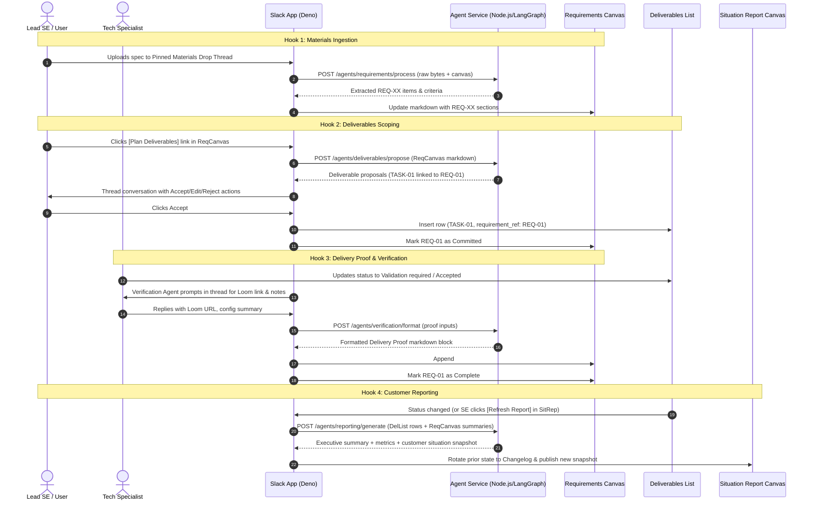

# Design: Requirements to Delivery Pipeline

## Architecture Overview

This design formalizes the continuous loop between problem discovery, execution tracking, outcome verification, and customer reporting. It eliminates per-task canvas sprawl by condensing all delivery proof into the single, living **Requirements Canvas**.



---

## Slack-Native State & Storage

All project state remains 100% Slack-native:
1. **Requirements Canvas (`requirements.hbs.md`)**:
   - Single canvas seeded per channel (`Requirements [proj-slug-tes]`).
   - Owns the complete problem definition and technical proof ledger.
2. **Deliverables List (`deliverables.json`)**:
   - Single Slack List seeded per channel (`Deliverables [proj-slug-tes]`).
   - Columns: `task_id` (Primary), `requirement_ref` (Text), `status` (Select), `assignee` (User), `situation` (Text), `category` (Text), `due_date` (Date), `open_questions` (Text).
3. **Situation Report Canvas (`situation-report.hbs.md`)**:
   - Single canvas seeded per channel (`Situation Report [proj-slug-tes]`).
   - Customer-facing executive metrics, blocker summaries, and requirement delivery excerpts.
4. **Dashboard Canvas (`dashboard.hbs.md`)**:
   - High-level project metadata, onboarding checklist, and direct links to all peer objects.

---

## Requirements Canvas Markdown Schema

Each requirement entry in `requirements.hbs.md` follows a standardized structure:

```markdown
## REQ-01: <Requirement Title>
- **Status:** Open | Committed | Complete | Blocked | Out of Scope
- **Linked Deliverables:** `TASK-01`
- **Customer Need:** <Verbatim or synthesized customer requirement>

### Acceptance Criteria
- [x] Criterion 1
- [ ] Criterion 2

### Delivery Proof & Outcome
<!-- populated by Verification Agent on delivery completion -->
- **Customer Summary:** <2-sentence non-technical outcome summary>
- **Visual Proof:** [Demo Loom Video](https://...)
- **Components:** SailPoint Identity Security Cloud, Entra ID Connector
- **Artefacts & Config:** Connector schema v1.2, sample XML attached
```

---

## Deno Slack SDK vs Node.js Agent-Service Boundary

- **`slack-app/` (Deno runtime)**:
  - Listens to channel message events, button clicks, and Slack List field changes.
  - Detects files dropped in the Materials Drop thread; warns users on general chatter file drops.
  - Reads and writes to Slack Canvases via `canvases.edit` and `canvases.access.set`.
  - Dispatches HTTP requests to `agent-service`.
- **`agent-service/` (Node.js runtime)**:
  - Houses the 4 LangGraph agents (`requirements`, `deliverables`, `verification`, `reporting`).
  - Implements document parsers (PDF, DOCX, XLSX).
  - Owns LLM prompt templates and output formatting.
  - Has zero access to Slack tokens or Slack APIs.

---

## Risks and Mitigations

| Risk | Mitigation |
| :--- | :--- |
| **Canvas Concurrency / Overwriting:** Multiple agent runs or manual edits modifying the Requirements Canvas simultaneously. | Agent updates target specific section markers or perform surgical regex section replacements, preserving existing human edits. |
| **Long Requirements Documents:** Large projects exceeding single canvas size limit (100,000 characters). | Requirements sections use concise markdown tables and bulleted criteria. Deep technical documents are linked as external attachments in the Materials thread rather than inlined verbatim. |
| **Orphaned Deliverables:** A deliverable created without a corresponding `requirement_ref`. | Deliverables List schema enforces `requirement_ref` populated on proposal acceptance; manual rows default to `REQ-MANUAL` or require SE assignment. |
